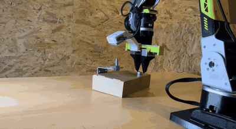
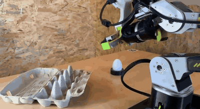

<h1 align="center">Stefan Rohringer</h1>

  <b>Robotics &amp; AI Architect</b> 
  Computer Vision · Industrial Automation · Physical AI · Agentic AI

  

  <a href="#videos">🎬 Videos</a> ·
  <a href="#projekte">🛠️ Projekte</a> ·
  <a href="#schwerpunkte">🧠 Schwerpunkte</a>

---

## 🎬 Videos

<table>
  <tr>
    <td width="50%" valign="top">
      
      
Vorschau im 3-fachen Zeitraffer · <a href="https://github.com/StefanRohringer/StefanRohringer/raw/main/video-1.mp4">🎥 Ganzes Video herunterladen (MP4)</a>

      <h3>Claude schraubt: KI-Roboterarm dreht eine Mutter auf</h3>
      
Claude steuert den reBot und dreht eine M10-Mutter auf einen senkrechten Gewindebolzen. Die Mutter wird gegriffen und über die Stange gesetzt; am Kraftanstieg im Greifer erkennt er, dass sie aufsitzt. Dann dreht er sie mit 27 Griffen zu je 60°, also 4,5 Umdrehungen.

      

        
        
        
      

      
Hardware: <a href="https://github.com/Seeed-Projects/reBot-DevArm">reBot DevArm von Seeed Studio</a>

    </td>
    <td width="50%" valign="top">
      
      
Vorschau im 14-fachen Zeitraffer · <a href="https://github.com/StefanRohringer/StefanRohringer/raw/main/video-2.mp4">🎥 Ganzes Video herunterladen (MP4)</a>

      <h3>Ganz vorsichtig: Roboterarm legt ein Ei in den Karton</h3>
      
Der reBot greift ein Ei von einem Ständer und legt es behutsam in einen Eierkarton.

      

        
        
        
      

      
Hardware: <a href="https://github.com/Seeed-Projects/reBot-DevArm">reBot DevArm von Seeed Studio</a>

    </td>
  </tr>
</table>

---

## 🛠️ Projekte

### 🦾 Robotik-Hardware

#### [Touch-Sensing Fin-Ray Gripper](https://github.com/StefanRohringer/Touch-Sensing-Fin-Ray-Gripper)

  

Greiferfinger mit Tastsinn für den Seeed reBot DevArm: Jeder Finger trägt zwei weiche Fin-Ray-Lamellen aus TPU, in jeder sitzt ein kleiner Magnet, dahinter ein Magnetometer (MLX90393). Alle vier Lamellen melden Kontakt einzeln, so spürt der Roboter beim Schließen, dass er das Teil hält, und beim Ablegen, dass es aufsetzt. Mit Fingernagel-Variante für winzige SMD-Bauteile (0603/0402), Druckdateien, Maßzeichnungen, Anschlussplan, interaktiver 3D-Ansicht, Firmware für den Raspberry Pi Pico und Live-Monitor für den PC.

   

### 🤖 Lokale KI-Systeme

#### [QuLSI](https://github.com/StefanRohringer/QuLSI)

Quantized Local Superintelligence: selbst gehosteter KI-Assistent, der komplett auf eigener Hardware läuft. Lokales LLM, Sprache, Kameras, Gedächtnis, Mail, Kalender und Smart Home.

 

#### [me-system](https://github.com/StefanRohringer/me-system)

Deterministisches (12×7)+10-Wissensnetz aus technischen Dokumenten. Kein LLM, keine Cloud, läuft auf einem Raspberry Pi.

 

### 🔒 Sicherheit für KI-Agenten

#### [me-guard](https://github.com/StefanRohringer/me-guard)

Lokales Vertrauens- und Integritätssystem für KI-Agenten-Skills: signiert, prüft und scannt Skills, bevor sie ausgeführt werden. 100 % offline und deterministisch.

 

### 🧪 Experimente

#### [binaer-experiment](https://github.com/StefanRohringer/binaer-experiment)

Kann ein LLM Programme direkt als Maschinencode schreiben? Testumgebung und Ergebnisse im Vergleich mit C.

 

---

## 🧠 Schwerpunkte

  
  
  
  
  
  
  
  

